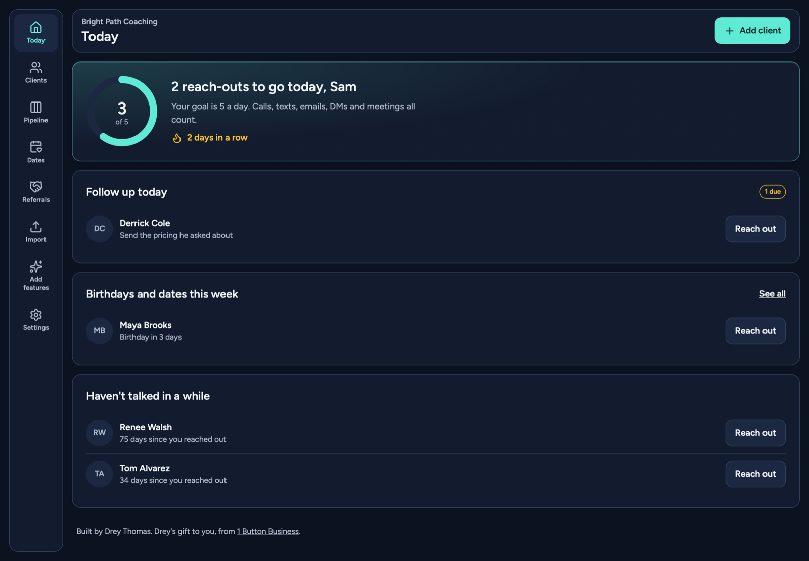
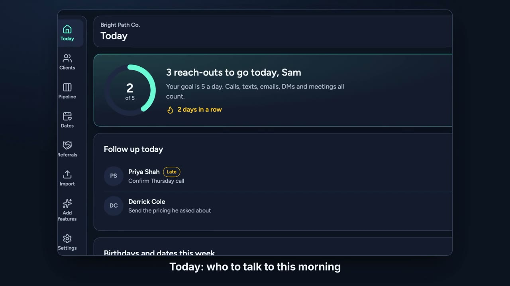
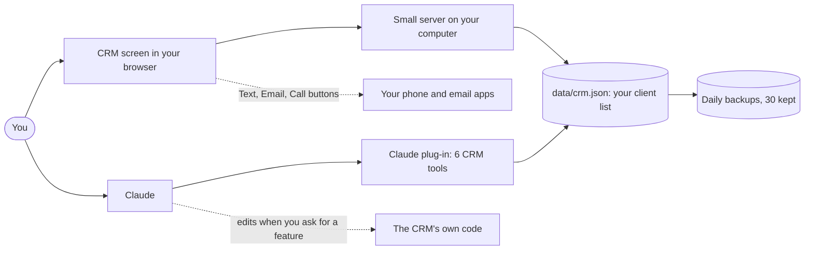

# Hit List CRM

A simple CRM that is yours. Made for real estate, lending, insurance, consulting and anyone who lives on referrals.

It runs on your own computer. No monthly fee, no account, no sales rep. When you want it to do something new, you ask Claude and Claude builds it.

**Built by Drey Thomas. This is Drey's gift to the members of [1 Button Business](https://1buttonbusiness.com).**



The people in the pictures are made up.

## Try it first

**[Open the live demo](https://1-button-business.github.io/crm-hit-list/)** and take the guided tour. It runs in your browser with made-up people, on a phone or a computer. Nothing to install.

[](https://1-button-business.github.io/crm-hit-list/tour.mp4)

**[Watch the 90-second tour](https://1-button-business.github.io/crm-hit-list/tour.mp4)**: why it helps, how to get the most from it, and how to change it by asking Claude.

Other flavors: [Client Roster](https://1-button-business.github.io/crm-client-roster/), [Hit List](https://1-button-business.github.io/crm-hit-list/), [Gift Book](https://1-button-business.github.io/crm-gift-book/).

## What it does on day one

| You want to | It gives you |
|---|---|
| Know who to talk to today | A Today screen with a daily reach-out goal and a streak |
| Stop letting people go quiet | A "Haven't talked in a while" list |
| Remember to follow up | A follow-up date on every person, including "in 3 months" |
| Keep notes on clients | A pinned note and a full history for each person |
| Text and email faster | Ready-made messages that open in your own phone and email apps |
| Track referrals | Who sent you whom, and which thank-yous you still owe |
| Remember birthdays | Birthdays and other dates, shown a week ahead |
| Send gifts | Gift ideas, mailing address, a gift log and a shop-on-Amazon button |
| See your pipeline | Everyone lined up by stage |
| Bring in a list | Import from ManyChat, a Google Form, a spreadsheet or your old CRM |
| Add anything else | An "Add features" screen with messages you paste into Claude |

## Start it (about 5 minutes)

You need the Claude desktop app. That is all.

1. Open Claude. Click the **Code** tab.
2. Paste this message and press Enter:

   ```
   Download https://github.com/1-Button-Business/crm-hit-list into my Documents folder. Install what it needs, start it, and open it in my browser. I am not technical, so explain each step in plain words.
   ```

3. Say yes when Claude asks permission. Your CRM opens in your browser at `http://localhost:4747`.

On the first screen, type your business name, then press **Load sample people** to look around. When you are ready, add your real people or import a list.

### Starting it again later

Open Claude in your CRM folder and say: **"Start my CRM."**

## Add features by asking

Open your CRM, click **Add features**, press **Copy message for Claude** on a card, and paste it into Claude. The full guide is in [ADD-A-FEATURE.md](ADD-A-FEATURE.md).

Claude is already plugged into your CRM. These work right away:

- "Who should I reach out to today, and what should I say?"
- "Here is a DM conversation. File it under the right person and set a follow-up."
- "I just got off a call with Maya. Log it. She wants to start in January."
- "Change my stages to New, Consult booked, Client, Alumni."

## Where your client list lives

In the `data` folder inside your CRM folder, on your computer. It is never uploaded anywhere.

- A backup copy is saved every day you use the CRM. The last 30 are kept in `data/backups`.
- Settings has a button to download everyone as a spreadsheet.
- To move to a new computer, copy the whole CRM folder.

## How it fits together



Built and tested today: everything in solid lines. Not built in: sending email or texts from inside the CRM, and using it on your phone. Those are upgrades Claude adds from the `recipes` folder.

Diagram source: [docs/diagrams/architecture.mmd](docs/diagrams/architecture.mmd)

## If something is not working

| What you see | What to do |
|---|---|
| "Your CRM is not answering" | The window that started it was closed. Tell Claude: "Start my CRM." |
| The page will not open | Tell Claude: "My CRM will not open. Fix it." |
| Something looks wrong after a change | Tell Claude: "Undo the last change." |
| You deleted someone by mistake | Tell Claude: "Restore my CRM from yesterday's backup." |

## For the curious

| Command | What it does |
|---|---|
| `npm start` | Runs the CRM at http://localhost:4747 |
| `npm test` | Checks the rules (quiet clients, birthdays, streaks, import, safety) |
| `npm run check` | Runs every check in one go. Run this before calling a change done. |

- Needs Node 22.18 or newer.
- Settings you can change by hand: `crm.config.ts`.
- Optional: `PORT=4748 npm start` to use a different port.
- [CLAUDE.md](CLAUDE.md) is the guide Claude reads before it changes anything.
- No keys or passwords are needed to run it.

## License

MIT. Use it, change it, make it your own, share it. Keep the line that says Drey Thomas built it. See [LICENSE](LICENSE).
